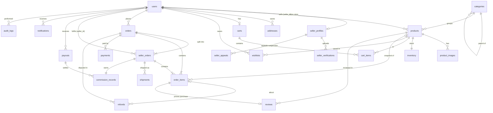

# Database design

MySQL 8, InnoDB, utf8mb4. All tables use `BIGINT UNSIGNED` auto-increment primary keys and `created_at` / `updated_at` timestamps (except the append-only `audit_logs`). Status columns are short strings backed by PHP enums in `app/Enums`, so new states don't need an `ALTER TABLE`.

## Entity–relationship diagram

## Key design decisions

| Concern | How it's handled |
|---|---|
| **Multi-vendor split** | One `orders` row per checkout; one `seller_orders` row per seller in it (`UNIQUE(order_id, seller_id)`). Sellers only ever see `seller_orders`. The parent status is derived from its children (`OrderStatus::fromSellerOrders`). |
| **Historical accuracy** | `order_items` stores `product_name`, `product_sku`, `product_image_url`, `unit_price` at checkout. `product_id` is nullable with `ON DELETE SET NULL`, and products are soft-deleted, so editing or removing a product never rewrites past orders. The delivery address is snapshotted as JSON on `orders.shipping_address`. |
| **No overselling** | `inventory.quantity` is `UNSIGNED` (the DB rejects negatives). Checkout runs in one transaction, locks every affected inventory row with `SELECT … FOR UPDATE` in product-id order (prevents deadlocks), re-checks quantities, then deducts. Cancellations and returns restock inside the same lock. |
| **Commission** | Rate snapshotted onto each `seller_orders` row and `commission_records` row, so changing a seller's rate only affects new orders. Commission is taken on item subtotal; shipping goes to the seller. Lifecycle: `pending` → `payable` (delivered) → `paid` (in a payout), or `reversed` (cancelled/returned). |
| **Money** | `DECIMAL(12,2)`; all arithmetic in integer centavos (`App\Services\Money`). |
| **Reviews** | `reviews.order_item_id` is `UNIQUE` — one review per purchased line, only after delivery. Product `rating_avg` / `rating_count` are denormalised for fast sorting. |
| **Search** | `FULLTEXT(name, short_description)` on MySQL plus composite indexes for the common filters (`status, moderation_status`, `category_id, status`, `price`, `sales_count`). |
| **Uniqueness** | `users.email`, `seller_profiles.store_slug`, `products.slug`, `UNIQUE(seller_id, sku)`, `UNIQUE(cart_id, product_id)`, `UNIQUE(user_id, product_id)` on wishlists. |
| **Integrity on delete** | Money-bearing rows use `RESTRICT` (you can't delete a seller who has orders); dependent rows (`cart_items`, `product_images`) `CASCADE`; reviewer/approver references `SET NULL`. |
| **Audit trail** | `audit_logs` is append-only (no `updated_at`): actor, action, polymorphic subject, old/new JSON, IP, user agent. |

## Tables

| Table | Purpose |
|---|---|
| `users` | All accounts. `role` = customer / seller / admin, `status` = active / suspended. Soft-deleted. |
| `seller_profiles` | Storefront: name, slug, branding, contact, approval `status`, `suspended_at`, optional commission override, cached `rating_avg`/`rating_count` (visible reviews on the seller's order items). |
| `seller_appeals` | A suspended seller's request for reinstatement: message, snapshot of the suspension reason, `status` open / accepted / denied, admin note and decider. |
| `seller_verifications` | Uploaded documents (stored on the private disk) and their review result. |
| `categories` | Two-level tree via `parent_id`. |
| `products` | Seller listings; seller-controlled `status`, admin-controlled `moderation_status`. |
| `product_images` | Ordered photos, one `is_primary`. |
| `inventory` | One row per product: `quantity`, `low_stock_threshold`, `low_stock_notified_at` (de-duplicates alerts). |
| `addresses` | Customer address book. |
| `carts`, `cart_items` | One cart per customer, items from any seller. |
| `orders` | Parent checkout: totals, COD payment status, address snapshot. |
| `seller_orders` | Per-seller part of an order: status timeline, shipping fee, commission, earnings. |
| `order_items` | Line items with snapshots. |
| `payments` | COD record (simulated confirmation on delivery), refund entries (negative amounts). |
| `shipments` | Courier, tracking number and JSON event log per seller order. |
| `commission_records` | Marketplace cut per seller order, linked to a payout once settled. |
| `payouts` | Bundles of payable commission records paid to a seller. |
| `refunds` | Return, refund and dispute requests and their resolution. |
| `reviews` | Verified-purchase product reviews. |
| `wishlists` | Saved products. |
| `notifications` | In-app notifications per user. |
| `audit_logs` | Who changed what. |
